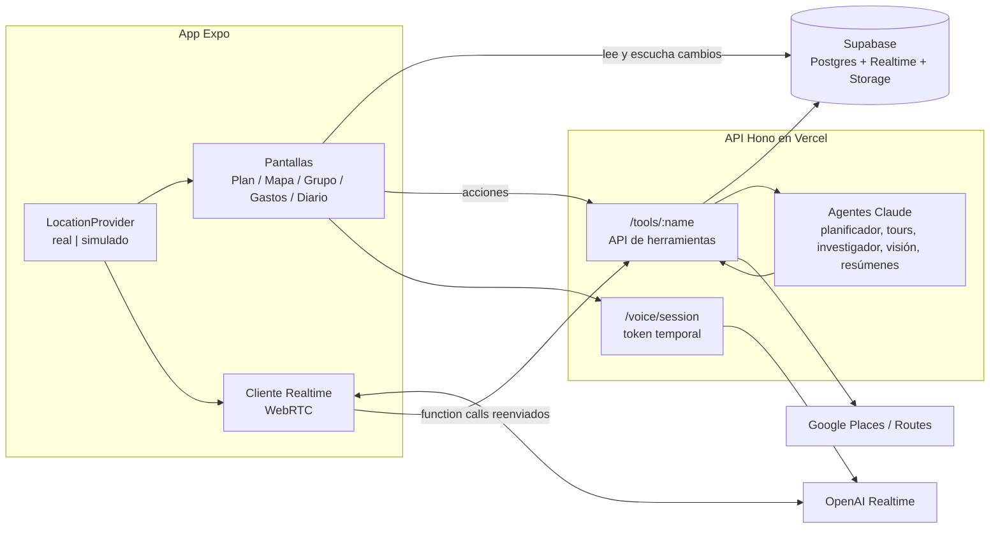

# 🏗️ 2 · Arquitectura

## Stack

| Capa | Elección | Notas |
| --- | --- | --- |
| App | **Expo (React Native) + TypeScript**, development build (no Expo Go) | Expo Router. Necesario por ubicación en segundo plano, geofencing, audio con pantalla bloqueada, Mapbox, CallKit, Live Activities. |
| Backend de datos | **Supabase** | Postgres + PostGIS + pgvector, Auth (Google), Realtime, Storage. |
| API | **TypeScript (Hono) en Vercel** | API de herramientas, agentes de Claude, token temporal de OpenAI Realtime. |
| Cerebro (agentes) | **Claude Sonnet 5.5** (`claude-sonnet-5-5`) con `@anthropic-ai/sdk` | Esfuerzo por trabajo: `high` planificador/tours, `medium` investigar/verificar, `low` visión/resúmenes. Tool Runner (`betaZodTool` + `toolRunner`), web search/fetch nativos, salidas estructuradas, streaming, `fallbacks` server-side. |
| Voz 1 a 1 | **OpenAI Realtime** (voz-a-voz, WebRTC desde el celu) | Token temporal desde la API. Se puede comparar con otros el sábado; cambiar es barato porque las herramientas viven en el backend. |
| Voz grupal (fase 2) | LiveKit + pipeline (Deepgram → Claude → TTS) | Solo si sobra tiempo. |
| Mapa | **Mapbox** (`@rnmapbox/maps`) | 3D, estilos, cámara animada. |
| Lugares y rutas | **Google Places (New) + Google Routes** | ⚠️ Deuda: los términos de Google prohíben mostrar Places sobre mapa no-Google. OK para hackathon; en producto real migrar a Foursquare/Mapbox Search o al mapa de Google. |
| Clima / eventos | Open-Meteo (sin key) + web search de Claude |  |

## Diagrama



## Principios (obligatorios)

1. **Las herramientas viven en el backend, no en el proveedor de voz.** Planificador, voz-a-voz y (fase 2) pipeline LiveKit llaman la misma API `/tools/:name` con los mismos esquemas Zod de `packages/shared`.
2. **La cámara es una herramienta** (`look_at_photo`): el celu saca la foto, la sube, Claude visión + GPS + orientación → texto que el guía narra.
3. **El agente propone en lo compartido y aplica en lo personal.** Toda acción del agente escribe en `activity_feed` y devuelve un `undo_token`.
4. **Sync por Supabase Realtime:** la app nunca hace polling. Los agentes escriben en la DB y la app se actualiza sola (el itinerario "se llena en vivo").
5. **`LocationProvider` abstracto desde el día 1:** `real` (expo-location + geofencing) o `simulated` (replay de un track grabado). Todo (mapa, geofences, tour, ubicación en vivo) consume la misma interfaz. Sin esto no hay demo en FIUM.
6. **Contenido verificado por adelantado.** Los tours se generan antes de caminar; en vivo el guía improvisa sobre esa base y admite no saber.
7. **Agentes asíncronos con progreso:** endpoints largos devuelven `job_id` y escriben progreso en `agent_jobs` (la app lo muestra en vivo).
8. **Secretos solo en el servidor.** La key de OpenAI nunca va al celu (token temporal).

## Estructura del repo

```javascript
/apps
  /mobile        Expo app (Expo Router)
  /api           Hono (Vercel)
/packages
  /shared        Zod schemas, tipos, constantes (fuente única de contratos)
/supabase
  /migrations    SQL (esquema = Contratos)
  seed.sql       viaje de demo + Ciudad Vieja curada
/docs
  CLAUDE.md      links a Notion + reglas
```

## Voz: flujo técnico (MVP)

1. App pide `POST /voice/session {mode, trip_id?, tour_id?}` → la API arma instrucciones (persona + resumen de contexto + memoria relevante + idioma) y la lista de herramientas, y devuelve un token temporal de OpenAI Realtime.
2. App conecta por WebRTC. Cuando el modelo pide una función, la app la reenvía a `POST /tools/:name` con el JWT del usuario y devuelve el resultado a la sesión.
3. Eventos del mundo (geofence, "quedan 30 min", foto) se inyectan como mensaje de sistema en la sesión y se pide respuesta.
4. Modo tour **dormido**: se cierra la sesión entre paradas y se reabre al despertar con un resumen (validar latencia de reconexión; alternativa: mantenerla abierta con el mic muteado).
5. Al cerrar: `voice_sessions.summary` + memorias extraídas (asíncrono, Claude `low`).

## Riesgos técnicos a validar temprano

- Ubicación + geofencing en segundo plano en iOS con dev build, y si se puede abrir/retomar audio Realtime desde background.
- Latencia de OpenAI Realtime en rioplatense + llamadas a herramientas confiables.
- Eco del parlante en la demo (sin auriculares).
- Mapbox 3D en el dev build.
